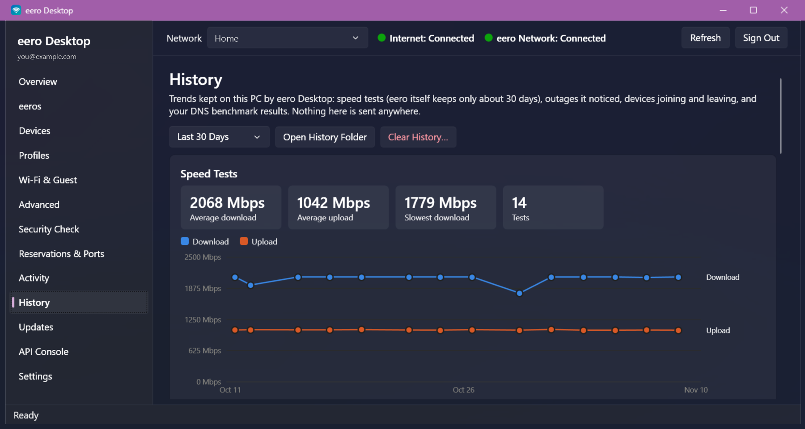

# eero Desktop

> [!IMPORTANT]
> **Unofficial application.** eero Desktop is not developed, endorsed or supported by eero LLC or Amazon.com, Inc.
> eero is a trademark of eero LLC, an Amazon company. It uses eero's cloud service the same way the eero mobile app
> does, and eero may change that service at any time. Use at your own risk; for official support, use the eero app or
> contact eero.

A Windows desktop app for managing an [eero](https://eero.com) mesh Wi-Fi network without a phone. It signs in with your
eero account and talks to the same cloud API as the eero Android app (v26.13.0).



## Features

- **Network at a glance:** internet and mesh health with status lights, eeros, connected devices, speed tests.
- **Devices and profiles:** rename, pause, block, assign profiles, reserve IPs; find devices that only have a
  machine-made name and get a suggested one; profiles with scheduled pauses and content filters.
- **Wi-Fi and guest network:** names and passwords (masked until you choose to show them).
- **Advanced settings, one change at a time:** UPnP, WPA3, IPv6, SQM, Thread, DNS and more. Each change re-reads the
  network, sends only that one setting, warns when eero will restart your eeros, and can be undone with
  **Undo Last Change**.
- **Ad blocking without eero Plus:** switch the network's DNS to AdGuard DNS or Control D.
- **DNS Benchmark:** compares your ISP's DNS with public resolvers using
  [dnspyre](https://github.com/Tantalor93/dnspyre) and can switch eero to the fastest.
- **Security Check:** reviews risky settings and every port open to the internet.
- **Reservations, port forwarding and IPv6 pinholes.**
- **History:** speed tests, outages, devices joining and leaving, and DNS benchmarks kept on your PC, with charts.
- **Tray and alerts:** keeps watching from the notification area; alerts when the internet or an eero goes down or a
  new device joins; monthly summary.
- **Light and dark themes**, start with Windows, backup and export.

Not included: setting up new eero hardware (done over Bluetooth by the eero app), eero Plus purchases, Alexa, and
Sign in with Amazon (invite an email address as a network admin in the eero app and sign in with that).

## Requirements

- Windows 10 or 11 (x64).
- An eero account that is an owner or admin of the network.
- To build: the [.NET 10 SDK](https://dotnet.microsoft.com/download/dotnet/10.0). The packaged app needs nothing
  installed.

## Build and run

```powershell
git clone https://github.com/JBA474/eero-desktop.git
cd eero-desktop

# Build and run (Debug)
dotnet build EeroDesktop\EeroDesktop.csproj
dotnet run --project EeroDesktop
```

Sign in with the email or phone number on your eero account; eero sends a one-time code. The session is saved
encrypted for your Windows account (DPAPI) at `%APPDATA%\EeroDesktop\session.bin`; **Sign Out** deletes it.

### Updates

Settings › About › **Check for Updates** looks at this repository's latest
[GitHub release](https://github.com/JBA474/eero-desktop/releases). **Download and Install** fetches its
`EeroDesktop.exe`, checks it against the SHA-256 checksum GitHub publishes for the file (it refuses anything that
doesn't match or has no checksum), swaps it in place of the running exe and restarts; sign-in, settings and history are
kept. The app also checks once a day and sends one notification per new version (Settings › Notifications to turn
off). Development builds (run from `bin\`) open the release page instead of replacing themselves.

To publish an update: raise `<Version>` in `EeroDesktop/EeroDesktop.csproj`, commit, run `tools\Publish.ps1`, and
create a release tagged `v<version>` with `dist\EeroDesktop.exe` attached (named `EeroDesktop.exe`).

### Package a single EXE

```powershell
.\tools\Publish.ps1              # dist\EeroDesktop.exe (self-contained) + "eero Desktop" shortcut on the Desktop
.\tools\Publish.ps1 -NoShortcut  # just the exe
```

The result is one self-contained `dist\EeroDesktop.exe` (about 70 MB, win-x64) that runs without .NET installed.

### Tests

```powershell
dotnet run --project tests\ApiTests   # offline: a local fake eero server, no account or network needed
.\tests\E2E.ps1                       # UI tests that drive the real app (needs a signed-in session; read-only)
.\tests\E2E.ps1 -SkipBuild -ExePath dist\EeroDesktop.exe   # test the packaged exe
```

The end-to-end tests use Windows UI Automation against your signed-in account and never change your network: they
don't restart, rename, block or change settings. Close the app first (the script closes any running copy).
Screenshots, `log.txt` and `results.csv` go to `tests\results\<timestamp>\`. Changes the automated tests never make
are listed, safest first, in [`tests/HANDS_ON_CHECKLIST.md`](tests/HANDS_ON_CHECKLIST.md).

## Project layout

| Path | Contents |
|---|---|
| `EeroDesktop/` | The WPF app (.NET 10, no NuGet dependencies) |
| `EeroDesktop/Api/` | eero API client, session storage, dnspyre runner, eero app release check |
| `EeroDesktop/Pages/` | One page per sidebar item |
| `tests/ApiTests/` | Offline tests against a fake eero server |
| `tests/E2E.ps1` | UI Automation end-to-end tests |
| `tools/` | `Publish.ps1`, `make-icon.ps1`, `Check-EeroApp.ps1`, `Compare-ApkApi.ps1` |
| `research/` | API notes mapped from the eero Android app (`API_MAP.md`, endpoint and model lists) |

---

# Details

## Pages
| Page | What it does |
|---|---|
| Overview | Internet/mesh health, IPs, latest speed test, firmware; run speed test, restart network, rename network |
| eeros | List units; restart, rename location, status light on/off and brightness, firmware history |
| Devices | Search/filter; rename, pause/resume, block/unblock, assign profile, reserve IP; "Needs a Name" filter |
| Profiles | Create/rename/delete, pause/resume, add/remove devices, scheduled pauses |
| Wi-Fi & Guest | Network name and password (copy/generate/change); guest network on/off, name, password |
| Advanced | UPnP, band steering, WPA3, IPv6, SQM, Thread, etc.; DNS (custom/automatic); DHCP info; eero Plus filters and block/allow sites |
| Security Check | Read-only review of risky settings and open ports |
| Reservations & Ports | IP reservations, port forwards, IPv6 pinholes |
| Activity | Speed-test history; data usage; notifications |
| History | Local trends kept by this app: speed tests (beyond eero's ~30 days), outages seen by the monitor, device activity, DNS benchmark results — charts, stat tiles and tables; 7/30/90/365 days or everything |
| Updates | Update status, update now, preferred update hour, firmware per eero |
| API Console | Any endpoint (presets included); `{network}` and `{res:name}` placeholders |
| Settings | Theme, startup and tray, notifications, backup and export, About |

## Icon

`EeroDesktop/Assets/AppIcon.ico` (16–256 px) is generated by `tools/make-icon.ps1`; rerun it to change the design.

## Tray, alerts and single instance

- Closing the window keeps eero Desktop running in the notification area (tray). Right-click the tray icon to open it,
  exit, or turn off: alerts when the internet or an eero goes down/comes back, alerts for devices never seen before,
  and "keep running in tray".
- Background checks run every 2 minutes and pause automatically if eero rate-limits (HTTP 429).
- Alert history: `%APPDATA%\EeroDesktop\alerts.log`. Known devices: `known-devices.json` (delete it to re-learn).
- Only one copy runs; launching again shows the existing window. `EeroDesktop.exe --exit` quits a running copy.

## Sessions

Expired sessions are renewed automatically (`POST 2.2/login/refresh`, then the request is retried once); a session
rotated by eero via `Set-Cookie: s=` is kept too.

## When eero changes its API

`tools\Compare-ApkApi.ps1 -Apk <newer eero APK>` decompiles it (with [jadx](https://github.com/skylot/jadx), placed in
`tools\jadx\`) and lists endpoints that were added or removed since 26.13.0, flagging the ones this app uses.

Knowing when to run it: the background monitor checks the eero app's Google Play page once a week and sends one
notification per newer version (Settings › Window & Startup to turn off; Settings › About shows the status and has
**Check for a New eero App**). `tools\Check-EeroApp.ps1` does the same check and, when there's a newer app, runs
Compare-ApkApi on the APK it finds in Downloads (`com.eero.android_<version>*.apk`, downloaded by you; `-Open` opens
APKMirror). Nothing is downloaded automatically.

## Undo Last Change

Before each Advanced-page switch or DNS change (including ad blocking and DNS Benchmark switches) is sent, the value it
replaces is saved in `undo.json`. **Undo Last Change** in the header (shown only when there's something to undo) asks
first, warns when it restarts the eeros, and sends one change; undoing again redoes. It survives restarts.

Device rename / pause / block / profile, profile rename / pause, Wi-Fi name and guest network name/on-off are undoable
too: each saves the exact request that undoes it and the one that redoes it. Passwords are never stored, so password
changes can't be undone.

## Security Check

Read-only page: Wi-Fi password length, WPA3, open guest network, UPnP, every enabled port forward (flagged when the
target IP has no reservation, nothing is online there, or it exposes an admin login such as SSH, Remote Desktop or a
NAS admin page), IPv6 pinholes (device gone/offline), devices that need a name, pending eero updates, eero Plus threat
blocking. Double-click a row to open the page that fixes it. Logic in `SecurityCheck.cs` (offline-tested).

## Devices that need a name

Devices › **Needs a Name** shows devices known only by a MAC address, a DNS hostname (e.g. `a1b2c3d4.example.net.`) or
a random default (e.g. `Android_8F3K2Q7Z`); Rename suggests a name from the manufacturer and device type
("Intel Laptop").

## IPv6 pinholes

Reservations & Ports › IPv6 Pinholes lists the device by name and MAC with a Service column (32400 = Plex, …) and can
**Add** a pinhole (body from the eero app's `NetRules.Pinhole`: url, device URL, protocol, port).

## Ad-blocking DNS

AdGuard DNS (94.140.14.14/94.140.15.15) and Control D's free "Ads & Tracking" servers (76.76.2.2/76.76.10.2) are offered on
the Advanced page and compared in the DNS Benchmark, which also says which ad blocker is fastest and what blocking costs.
eero Plus ad blocking (whole network or per profile) is supported too.

## Status lights and labels

Green = connected / online / green, red = disconnected / offline / red, yellow = anything in between (warnings, paused,
unknown) — in the header, Overview, eeros, Devices and History › Devices, always beside the status text. Labels use Title
Case via `J.Label` (eero and acronyms kept as written).

## History

Stored as JSON Lines in `%APPDATA%\EeroDesktop\history\` (`speedtests.jsonl`, `events.jsonl`, `dns-benchmarks.jsonl`,
`devices.jsonl`), kept 400 days (device joins/leaves 90 days; a device counts as gone after missing 2 checks). Included
in Back Up App Settings; restoring merges without duplicates. A monthly summary notification (speed, outages, DNS) is
sent once per month (Settings › Notifications; **Show Last Month's Summary** to see it again). Speed tests are copied
from eero every 6 hours by the monitor and whenever Activity or History opens. Outages are recorded whether or not
alerts are on; one that ends while the app is closed is closed at the first check after it starts (noted in the
details). Charts use a colorblind-checked palette with separate light and dark steps; every chart has a table beside it.

## Changing settings safely (one at a time)

Every change re-reads the network, is skipped when the value already matches, sends only that one setting, and is
never retried (`AppState.ChangeIfNeededAsync`). Request formats follow the decompiled eero app first, then the Home
Assistant integration / eero-api: settings fields are partial `PUT resources.settings` bodies (e.g. `{"upnp":true}`),
SQM is `PUT settings?sqm=true` with no body, Thread is `PUT {thread}/enable {"enabled"}`, power saving is
`PUT …/power_saving {"enable"}`, filters are form posts to `dns_policies/network` and `dns_policies/profiles/{id}`,
and per-profile ad blocking is `POST …/dns_policies/profiles/{id}/adblock {"enable"}`.
Any DNS change (custom servers, automatic, caching, ad-blocking DNS) makes eero restart every eero a few minutes later;
the app warns before sending it.

## More features

- **Advanced:** DNS caching, Thread, power saving, dynamic DNS, backup internet (eero Plus), threat blocking (eero Plus).
- **Profiles › Content Filters:** adult/illegal/violent/gaming/messaging/shopping/social/streaming blocking, SafeSearch,
  YouTube Restricted Mode, ad blocking (most need eero Plus).
- **eeros › Ports:** link, speed, role and connected device per port; turn a port off/on (not the internet port or an
  eero-to-eero link; warns for this PC's own port); power cycle all ports (optionally restarting the eero).
- **eeros › Nightlight:** off / always on / scheduled with brightness — shown only for eeros that have one (eero Beacon).

## Settings page

- **Appearance:** theme = Use Windows Setting / Light / Dark (applies immediately; tray menu follows on next start).
- **Window & Startup:** start with Windows (adds this .exe to the current user's Run key — no admin), start in the
  system tray, keep running in the tray when closed, outage / new-device / monthly-summary / new-eero-app
  notifications (kept in sync with the tray menu), test notification, alert history, forget known devices.
- **Backup & Export:** back up / restore app settings, known devices and history (never the eero sign-in); export a
  network snapshot as JSON (Wi-Fi passwords removed unless you tick the box; for reference only, not restored
  automatically); export devices to CSV.
- **About:** disclaimer, version, what the app does, credits, where it runs from and keeps its data.

Tests never use the Windows file dialogs or simulated keystrokes: `EERO_DESKTOP_TEST_FILE_DIR` makes Backup & Export
write to / read from a test folder instead.

## DNS Benchmark (dnspyre)

Advanced › DNS › **Benchmark DNS Servers…** uses [dnspyre](https://github.com/Tantalor93/dnspyre) by Tantalor93
(MIT License; docs: https://tantalor93.github.io/dnspyre/) to time A-record lookups for 20 popular sites against your
ISP's servers (eero "automatic"), eero's suggested public resolvers (Cloudflare, Google, OpenDNS, Quad9), AdGuard DNS,
Control D and any current custom servers — primary and secondary servers each, from this PC, one query at a time.

- Ranking: providers answering under 98% are excluded; the rest are ranked by 0.6 × median + 0.4 × 95th percentile.
- Results: table, a theme-aware comparison chart, and dnspyre's own graphs (latency histogram/boxplot/over time,
  response codes, throughput) for the selected provider; graphs are kept under `%LOCALAPPDATA%\EeroDesktop\dns-benchmark`.
- **Switch eero to the fastest** (or **Use Selected**) uses the one-change DNS write (`AppState.SetCustomDnsAsync` /
  `SetAutomaticDnsAsync`) after a warning that eero restarts every eero; it notes when this would turn off ad blocking.
- The window notes that results are measured from this PC (and what a Wi-Fi connection adds).
- dnspyre 3.12.0 is downloaded from the official GitHub release on first use (with consent), verified against SHA-256
  hashes pinned in `Api/Dnspyre.cs` (archive and exe, amd64/arm64), and cached in `%LOCALAPPDATA%\EeroDesktop\tools`.
- Credited in Settings › About with links to the source and documentation, plus its MIT license.

## Credits

- [dnspyre](https://github.com/Tantalor93/dnspyre) by Tantalor93 (MIT), based on dnstrace by Rahul Powar.
- API research helped by [eero-api](https://github.com/fulviofreitas/eero-api) and the
  [Home Assistant eero integration](https://github.com/schmittx/home-assistant-eero).
